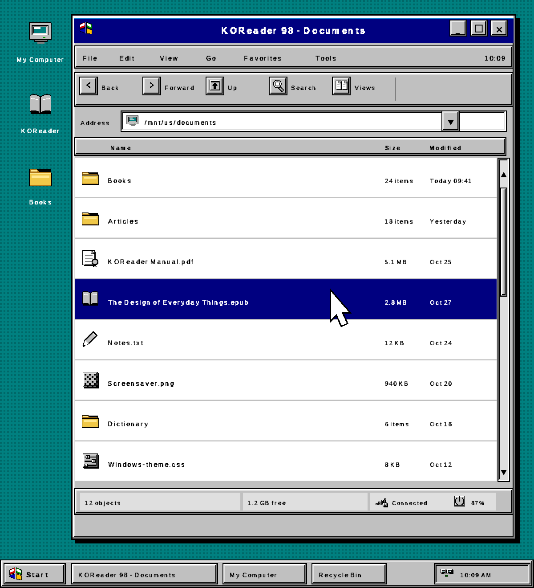
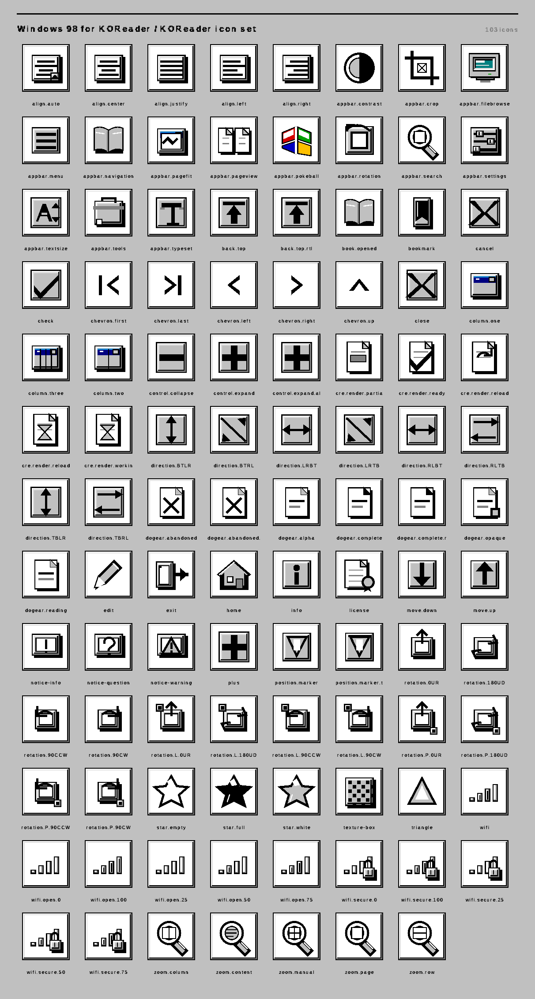
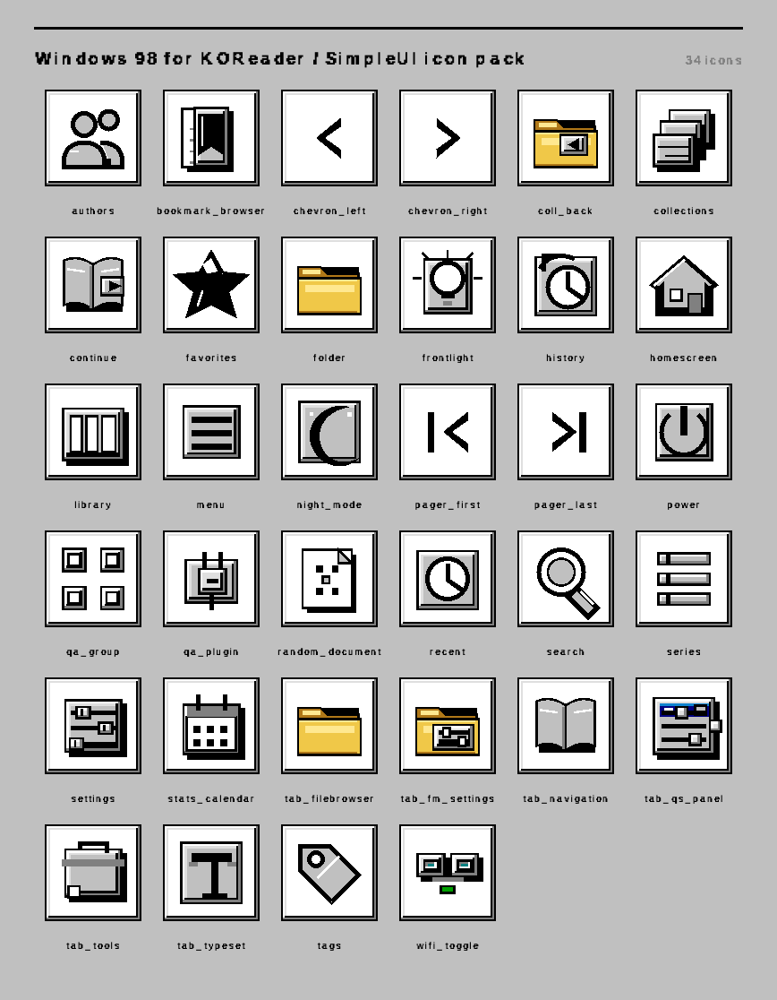
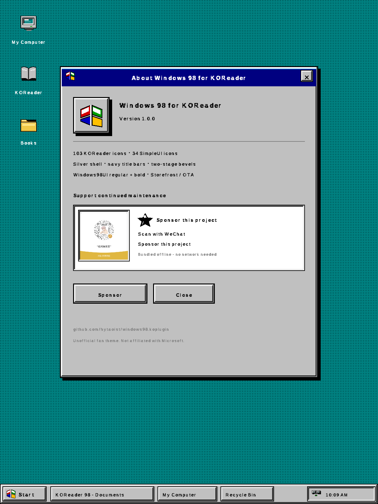

# Windows 98 for KOReader

把 Windows 98 的银灰外壳、深蓝标题栏、双层次立体边框、金色文件夹和经典桌面带到
Kindle Paperwhite 4 上的 KOReader 与 SimpleUI。

- Storefront 安装与 Update All 更新
- GitHub Release OTA 更新
- 103 个 KOReader 图标和 34 个 SimpleUI 图标
- `Windows98UI` 常规/粗体两套 UI 字体，中文自动回退
- 关于页内置微信赞赏码

[下载最新版本](https://github.com/hytaoist/windows98.koplugin/releases/latest)



## 使用要求

- Kindle Paperwhite 4，且已完成越狱
- 已安装 KOReader；当前验证版本为 `v2026.07.2`
- SimpleUI `3.0` 为可选增强，不是运行主题的必需条件

其他 Kindle 型号和 KOReader 版本可能可以使用，但尚未经过完整验证。

## 主要功能

- Windows 98 银灰窗口、深蓝活动标题栏、白色粗体标题
- 2 级凸起/凹陷斜面，黑色 1 px 外轮廓和硬阴影
- 金色文件夹、CRT 电脑、四色 Windows 徽标和外壳风格图标
- `Windows98UI` / `Windows98UI-Bold` 像素轮廓字体
- 方形按钮、内凹地址栏、经典蓝底白字选中态和菜单分隔线
- 不修改 KOReader 核心 Lua 源码；替换的文件均有备份，可从菜单恢复

<details>
<summary>查看完整图标集</summary>





</details>

## 安装

### Storefront（推荐）

1. 打开 KOReader 的 **Storefront**。
2. 搜索 **Windows 98 for KOReader**，或使用仓库 `hytaoist/windows98.koplugin`。
3. 安装后完全退出并重新打开 KOReader。

以后在 Storefront 中执行 **Update All** 即可更新。

### 手动安装

下载最新版 `windows98-v*.koplugin.zip`，解压到 `koreader/plugins/`，
最终目录应为：

```text
koreader/plugins/windows98.koplugin/
```

也可以在电脑上连接 Kindle 后运行：

```bash
./install.sh /Volumes/Kindle
```

安装完成后，完全退出 KOReader 再重新打开。如果主题没有出现，请确认 KOReader
已完全退出，而不是只返回了 Kindle 主界面。

## 更新

- Storefront 用户：**Storefront → Update All**
- 手动安装用户：**工具 → Windows 98 for KOReader → Check for updates**
- 也可以直接安装新版 ZIP 覆盖；重启 KOReader 后图标包和字体文件会被完整替换

OTA 会读取 `hytaoist/windows98.koplugin` 的最新 GitHub Release，并优先下载
`.koplugin.zip` 资产。更新后按提示重启 KOReader。

## 插件菜单

在 **工具 → Windows 98 for KOReader** 中可以：

- 重新安装或修复主题文件
- 检查 GitHub Release 更新
- 停用主题并恢复原文件
- 查看版本与关于信息

## 赞助



如果这个主题对你有帮助，可以在 Kindle 上扫码支持后续维护：

**工具 → Windows 98 for KOReader → About → Sponsor this project → Show WeChat reward code**

赞赏码已随插件离线打包，不需要联网即可全屏显示。

## 恢复与卸载

推荐先执行：

**工具 → Windows 98 for KOReader → Disable and restore original files**

然后从 Storefront 或 `koreader/plugins/` 中删除插件。也可以运行：

```bash
./uninstall.sh /Volumes/Kindle
```

## 更多

构建、测试、部署结构和发布流程见 [DEVELOPMENT.md](DEVELOPMENT.md)。

这是非官方粉丝主题，与 Microsoft 或 KOReader 项目没有隶属关系。代码使用 MIT
许可，生成图标使用 CC0；`Windows98UI` 字体由 Liberation Sans 生成，使用 SIL
Open Font License 1.1，详见 `assets/fonts/LICENSE-Windows98UI.txt`。
